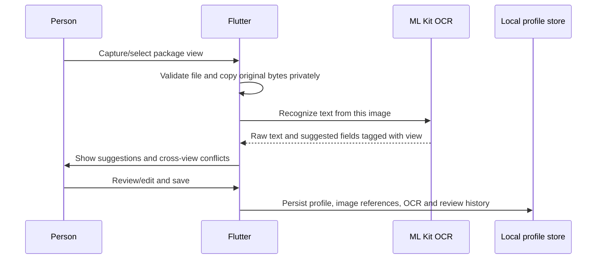

# PharmaAssist architecture

## Runtime boundaries

```mermaid
flowchart LR
  U[User] --> F[Flutter Android app]
  F -->|camera/gallery bytes for a requested screening| API[FastAPI]
  API --> Q[Image format and quality validation]
  Q --> M[EfficientNet-B0 checkpoint]
  M --> D[Conservative screening response]
  API -. optional structured explanation .-> O[Ollama]
  F --> L[Local app storage: history, medicine profiles, inspection notes]
  F -->|consented metadata only, bearer token| S[/sync/records]
  S --> DB[(SQLite sync database)]
  F -->|reviewed product fields; no image| V[/verification/official-alerts]
  V --> C[Fixed CDSCO alerts page and linked notices]
  V -. optional explanation, never status authority .-> O
```

## Flutter client

The Android client owns camera/gallery selection, local screening history,
editable medicine profiles, OCR suggestions, expiry status, user-entered
packaging observations, record search, and report export. Latin/Devanagari
recognition is performed through the existing ML Kit integration. The new
medicine-photo collection copies original selected image bytes into private
application documents storage; OCR suggestions are stored with their image
and remain user-editable. Legacy single-image profile fields remain readable.

The app has no on-device pharmaceutical image inference runtime. Screening
requires a configured backend. Offline mode continues to support local records
and reports, but does not generate predictions.

## Backend request paths

- `POST /predict` (and the existing screening aliases): validates and screens
  the submitted image. The service uses the available EfficientNet-B0
  pharmaceutical checkpoint; unavailable comparison architectures are not
  substituted silently. Optional Ollama output is advisory.
- `POST /sync/records`: authenticated, size-limited metadata synchronization.
  It is separate from prediction. Device credentials are provisioned and
  revocable; persisted token material is hashed. Sync does not accept image
  uploads from the current Flutter client.
- `POST /verification/official-alerts`: accepts reviewed product fields, not
  arbitrary URLs or images. The server reads the configured-in-code official
  CDSCO alerts page and only follows same-host HTTPS alert PDF links. A matching
  batch and product context can produce a potential-concern result. No alert
  match is never treated as verification. The current source integration does
  not provide positive manufacturer authentication; consequently it does not
  emit `officially_verified`.
- `GET /health`: reports backend and model/service availability.

## Data and failure behavior

The mobile local store is the working record source when offline. Sync queues
retain records after network failures and expose retry/conflict state. Server
sync uses SQLite transactions and idempotency checks. Verification history is
stored in the medicine profile on-device. External source and Ollama failures
yield an unavailable/unknown result rather than an authenticity claim. Logs
and outward errors should not contain device tokens, full uploaded content, or
submitted medicine values.

## Image and OCR flow



OCR is extraction assistance, not product verification. It leaves missing or
ambiguous fields blank and does not infer dates or batch values. Different
values from separate views are surfaced for review instead of silently
overwriting the saved profile.

## Model and explainability boundary

The backend registry lists several architectures, but the current project
capability statement is that only the verified EfficientNet-B0 checkpoint is
available for the supported screening path. Grad-CAM is a coarse model
activation visualization and is not chemical evidence. Historical benchmark
files describe particular held-out project datasets and must not be presented
as clinical or real-world validation.

## Local development

See [root setup](../README.md), [API reference](API_REFERENCE.md),
[synchronization design](HYBRID_SYNC_DESIGN_2026-11-05.md),
[security and privacy](SECURITY_AND_PRIVACY.md), and the Flutter client README.
